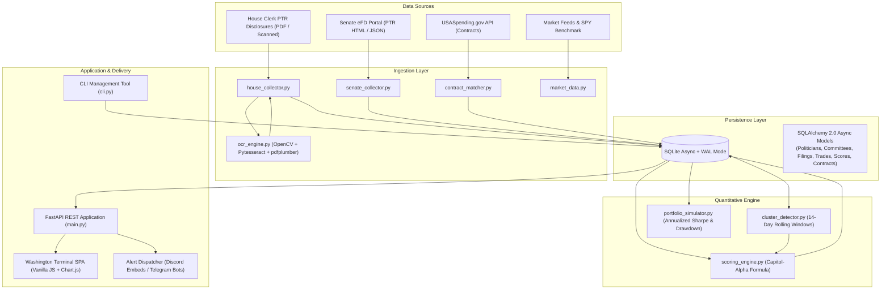
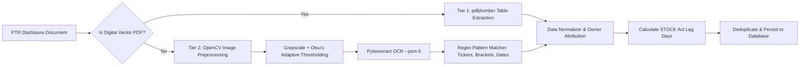

# CAPitAL — Institutional Congressional Trading Intelligence Platform

[](https://www.python.org/)
[](LICENSE)
[](https://fastapi.tiangolo.com/)
[](https://www.sqlalchemy.org/)
[-003B57.svg?logo=sqlite&logoColor=white)](https://sqlite.org/)
[-success.svg)](tests/)
[](docs/architecture.md)

> **CAPitAL** (*CapitolSeeder*) is an institutional-grade financial intelligence engine designed to capture, parse, quantitatively score, and cross-reference stock, option, and bond disclosures filed by members of the United States Congress (Senate and House of Representatives) and their spouses/dependents.

---

## Table of Contents

- [Overview](#overview)
- [Why This Project Exists](#why-this-project-exists)
- [Key Features](#key-features)
- [System Architecture](#system-architecture)
- [Data Ingestion & Multi-Tier OCR Pipeline](#data-ingestion--multi-tier-ocr-pipeline)
- [Quantitative Scoring Engine (Capitol-Alpha)](#quantitative-scoring-engine-capitol-alpha)
- [Project Directory Structure](#project-directory-structure)
- [Prerequisites & System Requirements](#prerequisites--system-requirements)
- [Installation & Setup](#installation--setup)
- [Configuration Reference](#configuration-reference)
- [Quick Start Guide](#quick-start-guide)
- [CLI Reference](#cli-reference)
- [REST API Reference](#rest-api-reference)
- [Washington Terminal Frontend](#washington-terminal-frontend)
- [Real-Time Webhook Alert Engine](#real-time-webhook-alert-engine)
- [Rasathane Telegram Kanalı (Türkçe)](#rasathane-telegram-kanalı-türkçe)
- [Development & Testing](#development--testing)
- [Troubleshooting Guide](#troubleshooting-guide)
- [Known Limitations](#known-limitations)
- [Security Considerations](#security-considerations)
- [Contributing](#contributing)
- [License](#license)

---

## Overview

Under the **Stop Trading on Congressional Knowledge (STOCK) Act of 2012**, members of Congress are legally mandated to report securities transactions within 45 days. However, disclosures arrive in fragmented formats: clean digital forms, multi-page vector PDFs, and degraded, handwritten scanned images submitted via the House Clerk and Senate Electronic Financial Disclosure (eFD) portals.

**CAPitAL** solves this fragmentation by providing an end-to-end ingestion, optical character recognition (OCR), normalization, quantitative correlation, and visualization platform. Disclosures are correlated in real time against:
1. **Congressional Committee Jurisdictions**: Cross-referencing member assignments against company sectors and industry keywords to measure direct conflicts of interest.
2. **Federal Procurement Contracts**: Matching traded entities against USASpending.gov award data to detect trades made in proximity to major government awards.
3. **Bipartisan Consensus Clusters**: Scanning rolling temporal windows to flag tickers accumulated concurrently by both Democrats and Republicans.
4. **Historical Benchmark Alpha**: Tracking copycat trade returns against the S&P 500 ($SPY) to simulate real-world shadow portfolio performance.
5. **STOCK Act Compliance**: Flagging disclosures exceeding the statutory 45-day deadline and calculating estimated overdue fines.

---

## Why This Project Exists

- **Information Asymmetry**: Congressional trading disclosures are publicly disclosed but intentionally difficult to systematically aggregate and interpret.
- **Scanned Document Bottlenecks**: Many high-value disclosures are uploaded as unsearchable scanned bitmaps or handwritten forms.
- **Contextual Correlation**: A stock purchase alone is meaningless without knowing whether the politician chairs the subcommittee regulating that exact industry or whether that company received a multi-billion-dollar defense procurement contract days later.
- **Auditability**: Provides an immutable, verifiable audit trail of filing dates, transaction dates, and statutory violations.

---

## Key Features

- **Multi-Tier Ingestion & OCR Engine**:
  - *Tier 1 (Digital Extraction)*: Vector table extraction using `pdfplumber` for natively generated digital PDF filings.
  - *Tier 2 (Computer Vision & OCR)*: OpenCV-based preprocessing (grayscale, Gaussian noise suppression, Otsu's adaptive binarization) and `pytesseract` PSM-6 table OCR for scanned or degraded disclosure sheets.
  - Automatic parsing of statutory monetary brackets (e.g., `$1,001 - $15,000` to `$50,000,000+`).
- **Composite Capitol-Alpha Scoring Algorithm**:
  - Six-factor quantitative model synthesizing committee conflicts, bipartisan clusters, historical win rate, transaction size, asset conviction, and disclosure decay penalties into an index score from $0$ to $100$.
- **Bipartisan Cluster Detector**:
  - Temporal scanning engine flagging simultaneous buying sprees on identical tickers across party lines within configurable rolling windows (e.g., 14 days).
- **Federal Procurement Cross-Referencing**:
  - Ticker-to-contractor matching with signed delta tracking between trade dates and federal contract award dates (e.g., Department of Defense, NASA, Department of Energy).
- **Shadow Portfolio Backtesting Simulator**:
  - Simulates copycat portfolio execution vs. S&P 500 ($SPY).
  - Trades on identical disclosure dates are grouped and averaged to eliminate unrealistic geometric compounding distortions.
  - Calculates Cumulative Alpha, Win Rate, Annualized Sharpe Ratio, and Maximum Drawdown.
- **STOCK Act Violation Auditing**:
  - Evaluates disclosure timeliness ($\Delta = \text{disclosure date} - \text{transaction date}$).
  - Categorizes severity (`None`, `Moderate` for 46–90 days, `Severe` for >90 days).
  - Calculates statutory fine liabilities ($200 base fine + $100 per 30 days overdue).
- **Washington Terminal Frontend SPA**:
  - Standalone single-page application built with vanilla JavaScript and CSS (Capitol Dark palette).
  - Includes Live PTR Ticker Marquee, Interactive Conflict Matrix, Politician Dossier modal, Side-by-Side Document/OCR Inspector, and Chart.js equity curve visualization.
- **Real-Time Notification Dispatcher**:
  - Structured Discord webhook embeds and Telegram markdown alerts triggered by high-alpha signals ($\ge 80$) or high conflicts ($\ge 85$).
  - Server-Side Request Forgery (SSRF) protection preventing loopback, private RFC-1918, link-local, and cloud metadata access.

---

## System Architecture



---

## Data Ingestion & Multi-Tier OCR Pipeline



### Ingestion Logic & Rules:
1. **Owner Type Attribution**: Disclosures classify trades as `Self`, `Spouse`, `Joint`, or `Dependent Child`. Spousal trades are tracked as primary alpha indicators.
2. **Asset Type Normalization**: Differentiates `Stock`, `Call_Option`, `Put_Option`, and `Bond`.
3. **Amendment Handling**: When an amended disclosure (`is_amendment = True`) is ingested, it links to `original_filing_id` to prevent duplicate transaction counting.
4. **Bracket Parsing**: Resolves range strings such as `"$1,001 - $15,000"`, `"$15,001 - $50,000"`, and `"$50,000,000+"` into statutory minimum, maximum, and midpoint values.

---

## Quantitative Scoring Engine (Capitol-Alpha)

Every executed trade is evaluated and assigned a **Composite Capitol-Alpha Score** clamped between $0$ and $100$:

$$\text{Composite Score} = \operatorname{clamp}\left(w_1 \cdot C_{\text{conflict}} + w_2 \cdot B_{\text{cluster}} + w_3 \cdot P_{\text{winrate}} + w_4 \cdot S_{\text{size}} + w_5 \cdot A_{\text{asset}} - \Lambda_{\text{decay}},\, 0,\, 100\right)$$

### Default Weights (Configurable in `config.py`):
| Factor | Weight | Variable | Description |
| :--- | :---: | :--- | :--- |
| **Committee Conflict** | $35\%$ ($w_1 = 0.35$) | $C_{\text{conflict}}$ | Overlap between committee jurisdictions and corporate business sectors |
| **Bipartisan Cluster** | $25\%$ ($w_2 = 0.25$) | $B_{\text{cluster}}$ | Multi-member buying consensus within a 14-day rolling window |
| **Track Record** | $15\%$ ($w_3 = 0.15$) | $P_{\text{winrate}}$ | Member historical win rate vs. S&P 500 benchmark |
| **Trade Size** | $15\%$ ($w_4 = 0.15$) | $S_{\text{size}}$ | Statutory bracket size midpoint |
| **Asset Conviction** | $10\%$ ($w_5 = 0.10$) | $A_{\text{asset}}$ | Instrument risk profile (leveraged options vs. equities vs. bonds) |
| **Freshness Decay** | Penalty ($0 - 30$) | $\Lambda_{\text{decay}}$ | Penalty for reporting lag; maximum deduction for STOCK Act violations |

### Component Formulas:

1. **Committee Conflict Score ($C_{\text{conflict}} \in [0, 100]$)**:
   - Direct jurisdiction keyword overlap $\ge 2$: **$90.0$** base.
   - Direct jurisdiction keyword overlap $= 1$: **$75.0$** base.
   - No overlap: **$0.0$** base.
   - **Leadership Bonus**: $+25.0$ points if member serves as Committee Chair or Ranking Member (capped at $100.0$).
2. **Bipartisan Cluster Score ($B_{\text{cluster}} \in [0, 100]$)**:
   - Both Democrats and Republicans purchased ticker within 14-day window: **$100.0$**.
   - $3+$ members of same party purchased ticker: **$60.0$**.
   - $2$ members of same party purchased ticker: **$30.0$**.
   - Isolated trade: **$0.0$**.
3. **Trade Size Score ($S_{\text{size}} \in [0, 100]$)**:
   - Midpoint $\le \$15,000 \rightarrow \mathbf{20.0}$
   - $\$15,001 - \$100,000 \rightarrow \mathbf{50.0}$
   - $\$100,001 - \$500,000 \rightarrow \mathbf{75.0}$
   - $\$500,001 - \$1,000,000 \rightarrow \mathbf{85.0}$
   - $> \$1,000,000 \rightarrow \mathbf{100.0}$
4. **Asset Conviction Score ($A_{\text{asset}} \in [0, 100]$)**:
   - Call Option (Bullish Leveraged Bet): **$100.0$**
   - Common Stock Purchase: **$70.0$**
   - Put Option (Bearish Speculation/Hedge): **$50.0$**
   - Municipal / Treasury Bond: **$10.0$**
   - Other / Unclassified: **$40.0$**
5. **Freshness Penalty ($\Lambda_{\text{decay}} \in [0, 30]$)**:
   - Lag $\le 5$ days: **$0.0$** deduction.
   - $5 < \text{Lag} \le 20$ days: **$-5.0$** deduction.
   - $20 < \text{Lag} \le 45$ days: **$-15.0$** deduction.
   - $\text{Lag} > 45$ days (STOCK Act Violation): **$-30.0$** deduction.

---

## Project Directory Structure

```text
CAPitAL/
├── .github/                            # GitHub Actions workflows & automation
│   └── workflows/
│       └── ci.yml                      # CI test matrix across Python 3.11, 3.12, 3.13
├── .env.example                        # Template for environment configuration
├── .gitignore                          # Comprehensive ignore rules
├── LICENSE                             # MIT License
├── CONTRIBUTING.md                     # Contribution guidelines & development workflow
├── SECURITY.md                         # Security policies, disclosure & SSRF defenses
├── README.md                           # Comprehensive documentation & quick-start guide
├── pyproject.toml                      # Build specification, dependencies & pytest config
├── capitolseeder/                      # Application root package
│   ├── __init__.py                     # Package metadata (__version__ = "0.1.0")
│   ├── config.py                       # Pydantic Settings (DB URLs, thresholds, weights)
│   ├── cli.py                          # Command-line interface (seed, serve)
│   ├── api/                            # FastAPI REST API layer
│   │   ├── __init__.py
│   │   ├── main.py                     # FastAPI app factory, CORS, static mounting
│   │   ├── schemas.py                  # Pydantic v2 request/response models
│   │   └── routers/                    # Modular API route controllers
│   │       ├── alerts.py               # Webhook registration & SSRF validation
│   │       ├── clusters.py             # Bipartisan cluster querying
│   │       ├── conflicts.py            # Live committee conflict endpoints
│   │       ├── politicians.py          # Member leaderboard and detail dossiers
│   │       ├── simulate.py             # Shadow portfolio backtest endpoint
│   │       ├── trades.py               # Filtered, paginated trade disclosures
│   │       └── violations.py           # STOCK Act violation audit & fines
│   ├── db/                             # Persistence & ORM layer
│   │   ├── __init__.py
│   │   ├── session.py                  # Async SQLAlchemy engine (SQLite WAL enabled)
│   │   └── models.py                   # Declarative ORM models (Politician, StockTrade, etc.)
│   ├── engine/                         # Quantitative models
│   │   ├── __init__.py
│   │   ├── scoring_engine.py           # Capitol-Alpha scoring algorithm
│   │   ├── cluster_detector.py         # Rolling-window cluster consensus detector
│   │   └── portfolio_simulator.py      # Copycat backtester vs. S&P 500 ($SPY)
│   ├── ingestion/                      # Data harvesting & normalization
│   │   ├── __init__.py
│   │   ├── congress_metadata.py        # Politician profiles & committee jurisdictions
│   │   ├── contract_matcher.py         # USASpending.gov contract correlation
│   │   ├── house_collector.py          # House PTR ingestion & schema normalization
│   │   ├── senate_collector.py         # Senate eFD disclosure parser
│   │   ├── market_data.py              # Price quotes and benchmark return calculator
│   │   └── ocr_engine.py               # OpenCV binarization & Pytesseract table OCR
│   ├── notifications/                  # Real-time alert dispatchers
│   │   ├── __init__.py
│   │   └── dispatcher.py               # Discord embed & Telegram alert formatters
│   ├── static/                         # Washington Terminal Frontend SPA
│   │   ├── index.html                  # Terminal layout & view containers
│   │   ├── sample_ptr_scanned.png      # Document sample for browser OCR inspector
│   │   ├── css/
│   │   │   └── terminal.css            # Capitol Dark CSS design tokens
│   │   └── js/
│   │       ├── app.js                  # Frontend controller & API client
│   │       ├── charts.js               # Chart.js equity curve visualizers
│   │       └── ocr_viewer.js           # Modal OCR side-by-side inspector
│   └── data/
│       └── seed/                       # Verified offline fixtures and document samples
│           ├── committees.json         # 8 congressional committee jurisdiction profiles
│           ├── politicians.json        # 6 representative congressional profiles
│           ├── trades.json             # 11 sample PTR transactions with contract matches
│           ├── sample_ptr_digital.pdf  # Vector digital PDF sample
│           ├── sample_ptr_scanned.png  # Degraded scanned PTR image sample
│           └── generate_sample_pdf.py  # Utility to synthesize test disclosure PDFs
├── docs/                               # System documentation & technical specifications
│   └── architecture.md                 # Complete technical architecture specification
└── tests/                              # Comprehensive test suite (33 tests)
    ├── test_api_endpoints.py
    ├── test_cluster_detector.py
    ├── test_config.py
    ├── test_congress_metadata.py
    ├── test_contract_matcher.py
    ├── test_db_models.py
    ├── test_e2e.py
    ├── test_house_collector.py
    ├── test_market_data.py
    ├── test_notifications.py
    ├── test_ocr_engine.py
    ├── test_portfolio_simulator.py
    ├── test_scoring_engine.py
    ├── test_seed_integrity.py
    ├── test_senate_collector.py
    └── test_static_assets.py
```

---

## Prerequisites & System Requirements

- **Operating System**: Linux, macOS, or Windows (Windows 10/11 fully supported).
- **Python**: Version `3.11`, `3.12`, or `3.13`.
- **System Dependencies (Optional for Scanned OCR)**:
  - `tesseract-ocr`: Required for Tier 2 image OCR (`pytesseract`).
    - *Debian/Ubuntu*: `sudo apt-get install tesseract-ocr`
    - *macOS*: `brew install tesseract`
    - *Windows*: Install via [UB-Mannheim installer](https://github.com/UB-Mannheim/tesseract/wiki) and ensure `tesseract.exe` is in your `PATH`.
    - *Note*: If Tesseract is not installed, the OCR engine gracefully falls back to structured digital extraction or simulated text.

---

## Installation & Setup

### 1. Clone Repository
```bash
git clone https://github.com/your-org/capitolseeder.git
cd capitolseeder
```

### 2. Create and Activate Virtual Environment
```bash
# Linux / macOS
python3 -m venv .venv
source .venv/bin/activate

# Windows (PowerShell)
python -m venv .venv
.venv\Scripts\Activate.ps1
```

### 3. Install Dependencies
```bash
pip install --upgrade pip
pip install -e ../ortak -e ".[dev]"
```

---

## Configuration Reference

Configuration is managed via Pydantic-Settings in `capitolseeder/config.py`. All parameters can be overridden using environment variables or a `.env` file in the root directory:

| Environment Variable | Type | Default | Purpose / Description |
| :--- | :---: | :---: | :--- |
| `APP_NAME` | string | `"CAPitAL"` | Brand identifier used in logs and HTTP headers |
| `ENVIRONMENT` | string | `"development"` | Environment mode (`development`, `production`, `test`) |
| `DEBUG` | boolean | `True` | Enables verbose debug logging |
| `DATABASE_URL` | string | `"sqlite+aiosqlite:///./capitolseeder.db"` | Async SQLAlchemy database connection URL |
| `WEIGHT_CONFLICT` | float | `0.35` | Scoring weight for committee conflict factor ($w_1$) |
| `WEIGHT_CLUSTER` | float | `0.25` | Scoring weight for bipartisan cluster factor ($w_2$) |
| `WEIGHT_WINRATE` | float | `0.15` | Scoring weight for member historical win rate ($w_3$) |
| `WEIGHT_SIZE` | float | `0.15` | Scoring weight for transaction statutory size ($w_4$) |
| `WEIGHT_ASSET` | float | `0.10` | Scoring weight for asset conviction factor ($w_5$) |
| `STOCK_ACT_GRACE_DAYS` | integer | `45` | Statutory disclosure window before violation occurs |
| `STATUTORY_FINE_BASE` | float | `200.0` | Base statutory civil penalty in USD for late filing |
| `HIGH_ALPHA_THRESHOLD` | float | `80.0` | Minimum composite score to trigger real-time alert |
| `HIGH_CONFLICT_THRESHOLD` | float | `85.0` | Minimum conflict score to trigger real-time alert |
| `DISCORD_WEBHOOK_URL` | string | `""` | Discord webhook URL for broadcasting trade alerts |
| `TELEGRAM_BOT_TOKEN` | string | `""` | Telegram Bot API token for dispatch |
| `TELEGRAM_CHAT_ID` | string | `""` | Telegram destination chat/channel ID |

---

## Quick Start Guide

### Step 1: Initialize Database & Populate Seed Data
Run the built-in CLI seeder to initialize the SQLite database tables (enabling WAL journal mode) and ingest politicians, committees, sample disclosure transactions, and federal contract matches:

```bash
python -m capitolseeder.cli seed
```
*Expected Output:*
```text
[OK] Successfully seeded 11 congressional transactions.
```

### Step 2: Start the Web Server & Washington Terminal
Launch the FastAPI application on port 8000:

```bash
python -m capitolseeder.cli serve --port 8000
```
*Expected Output:*
```text
[INFO] Launching CAPitAL Terminal on http://localhost:8000...
INFO:     Uvicorn running on http://0.0.0.0:8000 (Press CTRL+C to quit)
```

### Step 3: Access the Platform
- **Washington Terminal SPA**: Open [http://localhost:8000/](http://localhost:8000/) in any modern browser.
- **Interactive OpenAPI Documentation**: Open [http://localhost:8000/docs](http://localhost:8000/docs) (Swagger UI).
- **Alternative API Docs**: Open [http://localhost:8000/redoc](http://localhost:8000/redoc) (ReDoc).

---

## CLI Reference

The platform includes a unified command-line entry point `capitolseeder/cli.py`:

```bash
python -m capitolseeder.cli [COMMAND] [OPTIONS]
```

### Supported Commands:

| Command | Arguments / Flags | Description | Example |
| :--- | :--- | :--- | :--- |
| `seed` | *None* | Creates database tables, enables WAL mode, ingests committee fixtures, politician profiles, transactions, and computes Capitol-Alpha scores | `python -m capitolseeder.cli seed` |
| `serve` | `--port <int>` (Default: 8000) | Starts the Uvicorn ASGI server with live auto-reload enabled | `python -m capitolseeder.cli serve --port 8080` |

---

## REST API Reference

All API endpoints are versioned under `/api/v1` and return strict JSON payloads conforming to Pydantic v2 schemas:

### 1. Stock Trades (`/api/v1/trades`)
| Method | Endpoint | Query Parameters | Description |
| :--- | :--- | :--- | :--- |
| `GET` | `/api/v1/trades` | `party`, `chamber`, `committee`, `ticker`, `owner_type`, `is_violation`, `min_score`, `sort_by` (`disclosure_date`, `transaction_date`, `amount`, `alpha`), `order` (`desc`, `asc`), `page`, `page_size` | Returns a paginated list of congressional stock trades with full metadata, alpha scores, and contract matches. |

### 2. Politician Leaderboard & Dossiers (`/api/v1/politicians`)
| Method | Endpoint | Query Parameters | Description |
| :--- | :--- | :--- | :--- |
| `GET` | `/api/v1/politicians/leaderboard` | `chamber`, `party`, `sort_by` (`alpha`, `win_rate`, `volume`), `limit` | Ranked leaderboard of congressional members with win rate, trading volume, and average alpha score. |
| `GET` | `/api/v1/politicians/{bioguide_id}` | `bioguide_id` (Path parameter) | Comprehensive member dossier: bio, committee assignments, recent trades, sector allocation breakdown, and benchmark win rate. |

### 3. Bipartisan Clusters (`/api/v1/bipartisan-clusters`)
| Method | Endpoint | Query Parameters | Description |
| :--- | :--- | :--- | :--- |
| `GET` | `/api/v1/bipartisan-clusters` | `window_days` (default: 14), `min_parties` (default: 2) | Returns active ticker clusters where members across party lines executed purchases within the specified rolling window. |

### 4. Committee Conflict Matrix (`/api/v1/conflicts`)
| Method | Endpoint | Query Parameters | Description |
| :--- | :--- | :--- | :--- |
| `GET` | `/api/v1/conflicts/live` | `min_conflict_score` (default: 75.0), `has_contract` (boolean), `limit` | High-conflict transactions matched with committee oversight jurisdictions and federal contract awards. |

### 5. STOCK Act Compliance & Violations (`/api/v1/violations`)
| Method | Endpoint | Query Parameters | Description |
| :--- | :--- | :--- | :--- |
| `GET` | `/api/v1/violations` | `severity` (`Moderate`, `Severe`), `party`, `chamber`, `limit` | Late-filed disclosures exceeding the 45-day statutory limit, including overdue days and estimated statutory fines ($200 base + $100 per 30d). |

### 6. Shadow Portfolio Backtest Simulator (`/api/v1/simulate`)
| Method | Endpoint | Query Parameters | Description |
| :--- | :--- | :--- | :--- |
| `GET` | `/api/v1/simulate/shadow-portfolio` | `bioguide_id` (optional), `start_date`, `initial_capital` (default: 100000), `holding_days` (default: 90) | Backtests copycat trading vs. S&P 500 ($SPY), returning time-series equity curves, cumulative alpha, Sharpe ratio, and max drawdown. |

### 7. Real-Time Webhook Subscriptions (`/api/v1/alerts`)
| Method | Endpoint | Request Body | Description |
| :--- | :--- | :--- | :--- |
| `POST` | `/api/v1/alerts/webhook` | `{"webhook_url": str, "platform": "discord" \| "telegram" \| "slack", "min_score": int}` | Registers and validates an external webhook endpoint. Includes SSRF protection against loopback, private RFC-1918, and metadata IPs. |

### 8. System Health
| Method | Endpoint | Description |
| :--- | :--- | :--- |
| `GET` | `/health` | Returns `{"status": "healthy", "service": "CAPitAL"}`. |

---

## Washington Terminal Frontend

The web terminal located at `/` is a Single-Page Application optimized for financial analysts:

- **Live PTR Ticker**: Marquee stream of the latest disclosures with politician identity, asset, amount, and composite alpha badge.
- **Sidebar Filtering Panel**: Instant filtering across chambers (House/Senate), political parties (Democrat/Republican/Independent), ownership types (Self/Spouse/Joint), minimum alpha threshold, and ticker symbol.
- **View Modes**:
  1. **⚡ Live Disclosures**: Tabular audit view with expandable detail rows, contract correlation pills, and OCR inspector launchers.
  2. **🎯 Conflict Matrix**: Filtered grid highlighting committee leadership overlaps and corporate procurement relationships.
  3. **📈 Shadow Portfolio Simulator**: Interactive Chart.js equity curve comparing copycat performance against the S&P 500 index over 30 to 365-day holding horizons.
  4. **🏆 Member Leaderboard**: Ranked table of congressional traders by volume, win rate, and composite alpha score with clickable dossier modals.
  5. **⚠️ STOCK Act Audit**: Compliance dashboard calculating statutory penalties and days overdue.
- **OCR Side-by-Side Modal**: Displays parsed tabular rows alongside the original document scan.

---

## Real-Time Webhook Alert Engine

When new disclosures are ingested with a **Capitol-Alpha Score $\ge 80$** or a **Committee Conflict Score $\ge 85$**, alerts are formatted and dispatched asynchronously:

### Discord Embed Payload:
- **Title**: `🚨 HIGH ALPHA SIGNAL: $NVDA`
- **Color**: Gold (`0xf59e0b`), Purple (`0x8b5cf6`), or Red (`0xef4444`)
- **Fields**:
  - `🏛️ Politician`: Nancy Pelosi (Democrat-CA)
  - `📊 Asset & Size`: Call_Option • $1,000,001 - $5,000,000 (Spouse)
  - `🎯 Capitol-Alpha Score`: **86.5/100**
  - `🏢 Federal Contract Correlation`: Department of Energy: $145,000,000 (-11d relative to trade)
- **Direct Link**: Hyperlink directly to the official House Clerk or Senate eFD disclosure PDF.

---

## Rasathane Telegram Kanalı (Türkçe)

CAPitAL, Kongre üyelerinin hisse işlemi beyanlarını Rasathane grubunun (`t.me/rasathane`) **CAPitAL** konusuna Türkçe kartlar halinde gönderir. Kod `capitolseeder/kanal/` altında, uygulamanın geri kalanından (veritabanı, API, puanlar) bağımsızdır.

### Kartlar

| Kart | Ne zaman | İçerik |
|---|---|---|
| Günün Kongre Beyanları | Hafta içi, yeni hisse beyanı varsa | Son koşudan beri yeni görülen beyanlardan tutarı en büyük 8'i (üye başına en çok 3). 45 günden geç bildirilenler işaretli. |
| Haftanın Özeti | Cuma | Hafta içinde en çok farklı üyenin işlem yaptığı 8 hisse; alan/satan üye sayısı, parti dağılımı, iki partiden alım işareti. |
| Beyan Performansı | Ayın ilk Cuması | En az 5 alım beyan etmiş üyeler: alımlardan sonra hisselerin ortalama değişimi, aynı tarihlerde SPY ve fark. En yüksek ve en düşük beşer üye. |

Kartlar Rasathane'nin ortak Kâğıt düzenindedir; aynı gün birden çok kart çıkarsa her biri ayrı mesaj olarak, "CAPitAL · Kart adı · GG.AA.YYYY" satırıyla gider. Her kartta "Yatırım tavsiyesi değildir." yazar; kartlar beyanı aktarır, alım/satım önerisi içermez. Uygulamanın Capitol-Alpha, komite çakışması ve sözleşme eşleşmesi puanları örnek veriye dayandığı için kanala **girmez**.

**Veri:** [Kadoa congress-trading-monitor](https://github.com/kadoa-org/congress-trading-monitor) (MIT), House Clerk ve Senate eFD beyanlarının günlük derlemesi; yalnız Kongre satırları kullanılır. Görülen beyanlar `kanal/veri/beyanlar.csv`, gönderimler `kanal/veri/gonderimler.csv` dosyasında birikir. Performans için fiyatlar Yahoo Finance'ten (ücretsiz) alınır.

**Hata olursa:** kaynak indirilemez, bozuk ya da 10 günden eskiyse o gün hiçbir şey gönderilmez ve sahibine özel mesaj gider. Gönderim başarısız olursa arşiv güncellenmez; beyanlar ertesi gün yeniden "yeni" sayılır. Aynı gün iki kez gönderilmez.

### Kurulum (bir kez)

1. **Grup:** Rasathane forum (konular açık) olmalı. **CAPitAL** konusunu açın; yalnız yöneticiler yazabilsin. Botu grupta yönetici yapın (mesaj gönderme izni yeterli).
2. **Konu kimliği:** CAPitAL konusundaki herhangi bir mesaja sağ tıklayıp bağlantısını kopyalayın: `https://t.me/rasathane/<konu>/<mesaj>`. Ortadaki sayı konu kimliğidir.
3. **Kendi sohbet kimliğiniz** (hata bildirimi için): bota özelden `/start` yazın, sonra `https://api.telegram.org/bot<TOKEN>/getUpdates` adresinde `"chat":{"id": ...}` değerine bakın.
4. **GitHub → Settings → Secrets and variables → Actions:**
   - *Secrets:* `TELEGRAM_BOT_TOKEN` (BotFather'ın verdiği anahtar), `TELEGRAM_SAHIP_ID` (3. adımdaki sayı).
   - *Variables:* `TELEGRAM_HEDEF` = `@rasathane:<konu>` (ör. `@rasathane:12`). İleride ayrı kanala geçmek için yalnız bu değer değişir (`@kanal_adi`).
5. **İlk kuru koşu:** Actions → **Rasathane** → *Run workflow* ("Kuru çalıştır" işaretli). Bu koşu arşivi doldurur ve üç kartın önizlemesini üretir; hiçbir şey gönderilmez. Koşunun sayfasındaki **kartlar** çıktısını indirip kartlara bakın.
6. **Gönderimi açmak:** kartlar uygunsa *Variables* altına `KANAL_GONDER` = `1` ekleyin. Bundan sonra hafta içi her gün İstanbul saatiyle 23:30'da çalışır. Kapatmak için değişkeni silin ya da `0` yapın.

> Zamanlanmış iş yalnız varsayılan daldan (`main`) çalışır.

### Elle çalıştırmak

```bash
pip install -e ../ortak -e ".[kanal]"
python -m capitolseeder.kanal --kuru --hepsi      # gönderme, üç kartın önizlemesini kanal/cikti/ altına yaz
python -m capitolseeder.kanal --kuru --tarih 2026-11-06
```

`KANAL_GONDER=1` ortam değişkeni olmadan komut hiçbir zaman göndermez.

### Yedek: bilgisayarda Windows zamanlanmış görev

GitHub Actions kaynağa erişemezse aynı komut sahibinin bilgisayarında çalıştırılabilir. **Önce Actions iş akışını kapatın** (Actions → Rasathane → *Disable workflow*); ikisi aynı anda çalışmamalı. Görev Zamanlayıcı'da hafta içi 23:30 için şu komutu çalıştıran bir görev oluşturun (ortam değişkenleri `TELEGRAM_BOT_TOKEN`, `TELEGRAM_SAHIP_ID`, `TELEGRAM_HEDEF`, `KANAL_GONDER=1` kullanıcı değişkeni olarak tanımlı olmalı; bilgisayar o saatte açık olmalı):

```bash
git pull && python -m capitolseeder.kanal && git add kanal/veri && git commit -m "kanal: veri" && git push
```

---

## Development & Testing

### Test Execution
All unit, integration, and end-to-end tests are executed using `pytest` and `pytest-asyncio`:

```bash
# Run entire test suite directly
pytest

# Run with verbose output and test execution timing
pytest -v

# Run with test coverage reporting
pytest -v --cov=capitolseeder
```

### Current Test Suite Status:
- **33 Passed Tests**: 100% pass rate.
- **Total Code Coverage**: $80\%$ across all core modules.
- **Test Modules**:
  - `test_api_endpoints.py`: REST endpoint verification, SSRF blocking, query filtering.
  - `test_cluster_detector.py`: Rolling-window cluster consensus logic, purchase-only invariant.
  - `test_config.py`: Settings validation and defaults.
  - `test_congress_metadata.py`: Seeding and committee jurisdiction keyword extraction.
  - `test_contract_matcher.py`: USASpending contractor matching and signed day deltas.
  - `test_db_models.py`: SQLAlchemy 2.0 ORM CRUD, cascading deletes, foreign keys.
  - `test_e2e.py`: End-to-end pipeline execution from raw trade to scoring and API delivery.
  - `test_house_collector.py`: House PTR filing normalization and ownership parsing.
  - `test_market_data.py`: Alpha calculations and ticker quote retrieval.
  - `test_notifications.py`: Discord embed formatting and Telegram alert rendering.
  - `test_ocr_engine.py`: Bracket parsing, OpenCV binarization, STOCK Act lag calculation.
  - `test_portfolio_simulator.py`: Annualized Sharpe ratio, zero-variance handling, simultaneous trade compounding invariance, empty input tolerance.
  - `test_scoring_engine.py`: Capitol-Alpha scoring formula, leadership bonus isolation, zero-winrate handling.
  - `test_seed_integrity.py`: Schema validation of JSON fixtures and binary samples.
  - `test_senate_collector.py`: Senate eFD report normalization and option classification.
  - `test_static_assets.py`: Integrity of HTML, CSS, and JS frontend files.

---

## Troubleshooting Guide

### 1. `ModuleNotFoundError: No module named 'capitolseeder'`
- **Cause**: The current working directory is not in `PYTHONPATH`.
- **Solution**: Execute commands using the module syntax:
  ```bash
  python -m pytest
  python -m capitolseeder.cli seed
  ```
  Or install the repository in editable mode:
  ```bash
  pip install -e ../ortak -e .
  ```

### 2. Tesseract OCR Not Found or System Error
- **Cause**: `tesseract` is not installed on the host operating system or is not present in the system `PATH`.
- **Solution**:
  - On Ubuntu/Debian: `sudo apt install tesseract-ocr`
  - On Windows: Download the installer from UB-Mannheim and add `C:\Program Files\Tesseract-OCR` to your Environment Variables `PATH`.
  - *Note*: CAPitAL includes native fallback handling; if Tesseract is unavailable, Tier 1 digital extraction will still operate seamlessly.

### 3. Webhook Registration Fails with "Invalid or prohibited webhook URL (SSRF protection)"
- **Cause**: The submitted webhook URL resolves to `localhost`, a private IP range (`10.0.0.0/8`, `172.16.0.0/12`, `192.168.0.0/16`), a link-local address, or a cloud metadata endpoint (`169.254.169.254`).
- **Solution**: Provide a publicly resolvable HTTPS webhook URL (e.g., `https://discord.com/api/webhooks/...` or `https://webhook.site/...`).

### 4. Database Locked (`sqlite3.OperationalError: database is locked`)
- **Cause**: Concurrent read/write access on SQLite without WAL mode.
- **Solution**: CAPitAL automatically executes `PRAGMA journal_mode=WAL;` on startup in `session.py`. Ensure your database file is stored on a local filesystem (not over network NFS/SMB shares where SQLite file locking is unreliable).

---

## Known Limitations

1. **OCR Precision on Degraded Handwriting**: While OpenCV adaptive thresholding substantially cleans up scanned forms, heavily cursive or illegible handwriting on older disclosures may require manual verification via the built-in side-by-side OCR inspector.
2. **Offline Mode Contract Matching**: In environments without active internet connectivity, the USASpending matcher relies on the pre-mapped `TICKER_CONTRACTOR_MAP` fixtures rather than live federal procurement queries.
3. **Public API Authentication**: In the current v0.1.0 release, API endpoints do not require API keys or OAuth2 tokens. In multi-user production environments, deploy behind an API gateway (e.g., NGINX, Traefik, or Cloudflare Access).

---

## Security Considerations

- **Server-Side Request Forgery (SSRF) Hardening**: The webhook subscription router (`capitolseeder/api/routers/alerts.py`) strictly inspects hostnames and validates resolved IP addresses against loopback, link-local, private RFC-1918 blocks, and cloud metadata services.
- **SQL Injection Prevention**: All persistence operations utilize SQLAlchemy 2.0 async mapped queries and parameterized statements. Raw SQL string concatenation is prohibited.
- **Credential Protection**: Configuration parameters for external tokens (`DISCORD_WEBHOOK_URL`, `TELEGRAM_BOT_TOKEN`) are loaded via environment variables and never committed to source control.
- **Security Policy**: For responsible vulnerability disclosure instructions, see [SECURITY.md](SECURITY.md).

---

## Contributing

Contributions are welcome! Please refer to [CONTRIBUTING.md](CONTRIBUTING.md) for full development setup and workflow details.

1. **Fork the Repository**: Create a feature branch (`git checkout -b feature/amazing-feature`).
2. **Maintain Type Hints & Pydantic Validation**: Ensure all new API endpoints and services utilize strict type annotations and Pydantic v2 models.
3. **Write Unit Tests**: Add test cases under `tests/` covering new logic.
4. **Verify Test Suite**: Ensure all tests pass before submitting a Pull Request:
   ```bash
   pytest -v --cov=capitolseeder
   ```
5. **Open a Pull Request**: Submit your PR with a clear description of the rationale and architectural changes.

---

## License

This project is licensed under the **MIT License** (see [LICENSE](LICENSE) file).

---

## Acknowledgements

- **U.S. House of Representatives Office of the Clerk**: Public Financial Disclosure records.
- **U.S. Senate Financial Disclosures**: Electronic Financial Disclosure (eFD) system.
- **USASpending.gov**: Open data on federal contract and procurement awards.
