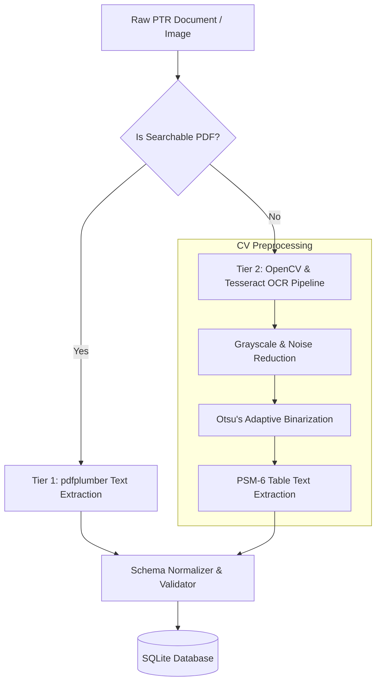

# CAPitAL — System Architecture & Technical Specification

## 1. Executive Summary & System Objectives

**CAPitAL** (*CapitolSeeder*) is an institutional-grade financial intelligence platform engineered to ingest, parse (including multi-tier OCR on scanned/handwritten forms), normalize, quantitatively score, and cross-reference stock, option, and bond transactions disclosed by members of the United States Congress (Senate and House of Representatives) and their spouses/dependents.

The platform continuously correlates these disclosures with:
1. **Active Committee Assignments**: Cross-referencing congressional committee jurisdictions against company sectors and industry keywords to quantify direct conflicts of interest.
2. **Federal Contract Awards**: Matching traded entities against USASpending.gov procurement data to identify trades executed in proximity to major federal contracts.
3. **Bipartisan Consensus Clusters**: Scanning rolling temporal windows to flag tickers accumulated concurrently across party lines.
4. **Historical Benchmark Alpha**: Tracking copycat portfolio returns against the S&P 500 ($SPY) to simulate real-world shadow portfolio performance.
5. **STOCK Act Compliance**: Flagging disclosures exceeding the statutory 45-day deadline and auditing estimated overdue fine liabilities.

---

## 2. Micro-Pipeline Architecture

CAPitAL follows a modular, asynchronous micro-pipeline architecture:

```
capitolseeder/
├── pyproject.toml              # Build specification & runtime dependencies
├── config.py                   # Pydantic Settings (DB URLs, thresholds, weights)
├── cli.py                      # Command-line interface (seed, serve)
├── db/
│   ├── session.py              # Async SQLAlchemy engine (SQLite WAL enabled)
│   └── models.py               # SQLAlchemy 2.0 ORM models
├── ingestion/
│   ├── house_collector.py      # House XML index + Multi-Tier PDF/OCR parser
│   ├── senate_collector.py     # Senate eFD search & JSON normalizer
│   ├── congress_metadata.py    # Bioguide IDs, committee jurisdictions, member metadata
│   ├── contract_matcher.py     # USASpending.gov contract correlation engine
│   ├── market_data.py          # Price quotes and benchmark return calculators
│   └── ocr_engine.py           # OpenCV binarization & Pytesseract table OCR
├── engine/
│   ├── scoring_engine.py       # Composite Capitol-Alpha scoring algorithm
│   ├── cluster_detector.py     # Rolling-window cluster consensus detector
│   └── portfolio_simulator.py  # Copycat backtester vs. S&P 500 ($SPY)
├── api/
│   ├── main.py                 # FastAPI app factory, CORS, static mounting
│   ├── schemas.py              # Pydantic v2 request/response schemas
│   └── routers/                # Modular API route controllers
│       ├── trades.py           # Filtered, paginated trade disclosures
│       ├── politicians.py      # Member leaderboard and detail dossiers
│       ├── clusters.py         # Bipartisan cluster querying
│       ├── conflicts.py        # Live committee conflict endpoints
│       ├── violations.py       # STOCK Act violation audit & fines
│       ├── simulate.py         # Shadow portfolio backtest endpoint
│       └── alerts.py           # Webhook registration & SSRF validation
├── notifications/
│   └── dispatcher.py           # Discord embed & Telegram alert formatters
├── data/
│   └── seed/                   # Verified offline fixtures and document samples
│       ├── sample_ptr_digital.pdf
│       ├── sample_ptr_scanned.png
│       ├── politicians.json
│       ├── committees.json
│       └── trades.json
└── static/                     # Washington Terminal Frontend SPA
    ├── index.html              # Single-page terminal interface
    ├── css/
    │   └── terminal.css        # Capitol Dark CSS design tokens
    └── js/
        ├── app.js              # Frontend controller & API client
        ├── charts.js           # Chart.js visualizers
        └── ocr_viewer.js       # Modal OCR side-by-side inspector
```

---

## 3. Database Schema (SQLAlchemy 2.0 ORM)

The platform utilizes asynchronous SQLite (`sqlite+aiosqlite`) with Write-Ahead Logging (WAL) enabled on startup for concurrent reads and writes.

### 3.1 `Politician` Model
- `bioguide_id` (String(10), Primary Key): Official congressional identifier (e.g., `P000197`, `M001157`).
- `first_name` (String(64), Not Null)
- `last_name` (String(64), Not Null, Indexed)
- `chamber` (String(10), Not Null): `'House'` or `'Senate'`.
- `party` (String(20), Not Null, Indexed): `'Democrat'`, `'Republican'`, or `'Independent'`.
- `state` (String(2), Not Null, Indexed): Two-letter US state code.
- `district` (Integer, Nullable): Congressional district number for House members.
- `leadership_title` (String(128), Nullable): e.g., `'Speaker Emeritus'`, `'Ranking Member'`.
- `image_url` (String(512), Nullable)
- `active` (Boolean, Default True)
- `win_rate` (Float, Default 0.0): 90-day win rate percentage against S&P 500.
- `total_volume` (Float, Default 0.0): Sum of estimated midpoint trade values in USD.
- `alpha_score` (Float, Default 0.0): Average composite alpha score across closed trades.

### 3.2 `CommitteeMembership` Model
- `id` (Integer, Primary Key, Autoincrement)
- `bioguide_id` (String(10), ForeignKey(`politicians.bioguide_id`), Indexed)
- `committee_code` (String(16), Not Null): e.g., `'HSAF'`, `'SSCI'`, `'SSBK'`.
- `committee_name` (String(255), Not Null)
- `subcommittee_name` (String(255), Nullable)
- `role` (String(32), Default `'Member'`): `'Chair'`, `'Ranking Member'`, or `'Member'`.
- `jurisdiction_keywords` (JSON, Not Null): List of lower-case strings matching industries and technologies regulated by this committee (e.g., `["defense", "aerospace", "semiconductors", "weapons"]`).

### 3.3 `TransactionReport` (PTR Filing) Model
- `filing_id` (String(64), Primary Key): Unique document identifier from House Clerk or Senate eFD.
- `bioguide_id` (String(10), ForeignKey(`politicians.bioguide_id`), Indexed)
- `chamber` (String(10), Not Null): `'House'` or `'Senate'`.
- `filing_type` (String(16), Default `'PTR'`): Periodic Transaction Report.
- `filing_date` (Date, Not Null, Indexed)
- `doc_url` (String(512), Not Null)
- `is_amendment` (Boolean, Default False, Indexed)
- `original_filing_id` (String(64), Nullable)
- `ocr_processed` (Boolean, Default False)
- `ocr_raw_text` (Text, Nullable)

### 3.4 `StockTrade` Model
- `id` (Integer, Primary Key, Autoincrement)
- `filing_id` (String(64), ForeignKey(`transaction_reports.filing_id`), Indexed)
- `bioguide_id` (String(10), ForeignKey(`politicians.bioguide_id`), Indexed)
- `ticker` (String(10), Not Null, Indexed): Stock or underlying asset ticker.
- `company_name` (String(255), Not Null)
- `asset_type` (String(32), Not Null): `'Stock'`, `'Call_Option'`, `'Put_Option'`, `'Bond'`.
- `transaction_type` (String(16), Not Null): `'Purchase'`, `'Sale'`, `'Exchange'`.
- `transaction_date` (Date, Not Null, Indexed)
- `disclosure_date` (Date, Not Null, Indexed)
- `amount_range_str` (String(64), Not Null): Original bracket string (e.g., `"$15,001 - $50,000"`).
- `amount_min` (Float, Not Null)
- `amount_max` (Float, Not Null)
- `amount_midpoint` (Float, Not Null)
- `owner_type` (String(32), Default `'Self'`): `'Self'`, `'Spouse'`, `'Joint'`, `'Dependent Child'`.
- `option_strike` (Float, Nullable)
- `option_expiration` (Date, Nullable)
- `filing_lag_days` (Integer, Not Null): `(disclosure_date - transaction_date).days`.
- `is_stock_act_violation` (Boolean, Default False, Indexed): True if `filing_lag_days > 45`.
- `violation_severity` (String(16), Default `'None'`): `'None'`, `'Moderate'` (46-90 days), `'Severe'` (>90 days).
- `price_at_transaction` (Float, Nullable)
- `price_at_disclosure` (Float, Nullable)
- `return_30d` (Float, Nullable): Percentage return 30 days post-disclosure.
- `return_90d` (Float, Nullable): Percentage return 90 days post-disclosure.
- `benchmark_return_90d` (Float, Nullable): SPY return over identical 90-day window.

### 3.5 `FederalContractMatch` Model
- `id` (Integer, Primary Key, Autoincrement)
- `trade_id` (Integer, ForeignKey(`stock_trades.id`), Indexed)
- `agency_name` (String(255), Not Null): Awarding agency (e.g., `'Department of Defense'`).
- `contract_id` (String(128), Not Null)
- `award_date` (Date, Not Null)
- `award_amount` (Float, Not Null)
- `days_between_trade_and_contract` (Integer, Not Null): Signed delta between trade date and contract award date.
- `match_confidence_score` (Float, Default 1.0): 0.0 to 1.0.

### 3.6 `CapitolAlphaScore` Model
- `id` (Integer, Primary Key, Autoincrement)
- `trade_id` (Integer, ForeignKey(`stock_trades.id`), Unique, Indexed)
- `conflict_score` (Float, Not Null): 0.0 to 100.0.
- `cluster_score` (Float, Not Null): 0.0 to 100.0.
- `winrate_score` (Float, Not Null): 0.0 to 100.0.
- `size_score` (Float, Not Null): 0.0 to 100.0.
- `asset_score` (Float, Not Null): 0.0 to 100.0.
- `decay_penalty` (Float, Not Null): 0.0 to 30.0.
- `composite_alpha_score` (Float, Not Null, Indexed): 0.0 to 100.0.
- `rationale` (JSON, Not Null): Detailed key-value pairs explaining scoring factors.

### 3.7 `WebhookSubscriber` Model
- `id` (Integer, Primary Key, Autoincrement)
- `webhook_url` (String(512), Unique, Not Null, Indexed)
- `platform` (String(32), Default `'discord'`)
- `min_score` (Integer, Default 80)
- `created_at` (Date, Default `datetime.date.today`)
- `is_active` (Boolean, Default True)

---

## 4. Multi-Tier Ingestion & OCR Pipeline



1. **Tier 1 (Digital Extraction)**: Fast vector extraction using `pdfplumber` for natively generated digital PDF filings.
2. **Tier 2 (Computer Vision & OCR)**: OpenCV-based preprocessing (grayscale, Gaussian noise suppression, Otsu's adaptive binarization) and `pytesseract` PSM-6 table OCR for scanned or degraded disclosure sheets.
3. **Statutory Bracket Parsing**: Robust regular expressions handle standard congressional monetary ranges, open-ended brackets (`$50,000,000+`), and parenthetical ownership notes.

---

## 5. Quantitative Scoring Engine (Capitol-Alpha)

### 5.1 Mathematical Formulation

$$\text{Composite Score} = \operatorname{clamp}\left(0.35 \cdot C_{\text{conflict}} + 0.25 \cdot B_{\text{cluster}} + 0.15 \cdot P_{\text{winrate}} + 0.15 \cdot S_{\text{size}} + 0.10 \cdot A_{\text{asset}} - \Lambda_{\text{decay}},\, 0,\, 100\right)$$

### 5.2 Factor Descriptions

| Factor | Weight | Dynamic Range | Description |
| :--- | :---: | :---: | :--- |
| **Committee Conflict ($C$)** | 35% | $0 - 100$ | Matches committee jurisdiction keywords against traded company sectors and federal procurement awards. Includes $+25$ bonus for Committee Chairs or Ranking Members. |
| **Bipartisan Cluster ($B$)** | 25% | $0 - 100$ | Scores accumulation across party lines within rolling temporal windows (e.g., 14 days). $100$ for cross-party buys, $60$ for $3+$ same-party buys, $30$ for $2$ same-party buys. |
| **Politician Win Rate ($P$)** | 15% | $0 - 100$ | Historical 90-day beat rate against $SPY with Bayesian smoothing for low-trade sample sizes. |
| **Transaction Size ($S$)** | 15% | $0 - 100$ | Piecewise bracket scoring ($20$ for $<\$15\text{K}$, up to $100$ for $>\$1\text{M}$). |
| **Asset Conviction ($A$)** | 10% | $0 - 100$ | Leveraged call options ($100$), common stock ($70$), put options ($50$), bonds ($10$). |
| **Filing Freshness Penalty ($\Lambda$)** | Subtractive | $0 - 30$ | Penalizes delayed disclosures. $\le 5$ days: $0$; $6-20$ days: $5$; $21-45$ days: $15$; $>45$ days (violation): $30$. |

---

## 6. Server-Side Request Forgery (SSRF) Hardening

External webhook registration (`/api/v1/alerts/webhook`) implements strict multi-layer SSRF defenses:
- Verifies scheme is `https` or `http`.
- Prohibits known loopback hostnames (`localhost`, `127.0.0.1`, `::1`, `0.0.0.0`).
- Resolves DNS addresses through `socket.getaddrinfo` and inspects IP addresses via Python's `ipaddress` module to block:
  - Private RFC-1918 blocks (`10.0.0.0/8`, `172.16.0.0/12`, `192.168.0.0/16`)
  - Loopback (`127.0.0.0/8`)
  - Link-local and IPv6 link-local (`169.254.0.0/16`, `fe80::/10`)
  - Cloud provider metadata IP (`169.254.169.254`)
  - Reserved ranges
- Supports strict domain whitelisting fallback for containerized/mock test environments.
